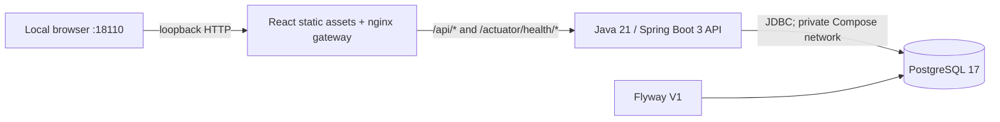
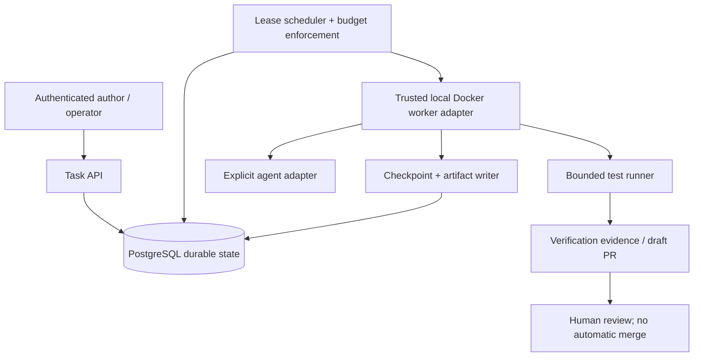

# Architecture

## Phase 1 runtime

Only the gateway publishes a host port. The API and database are reachable only
inside the project's Docker network. Container memory/CPU limits bound this
skeleton's local footprint; these are not worker isolation guarantees.

The gateway serves the built frontend and forwards API/health requests to one
backend. There is no browser-side fallback service and no mock-success mode.
Readiness queries the actual database; liveness does not depend on it.

## Phase 1 interfaces and ownership

| Interface                         | Owner           | Behavior                                                                                     |
| --------------------------------- | --------------- | -------------------------------------------------------------------------------------------- |
| `GET /api/v1/system`              | API             | Reads installation metadata from PostgreSQL; exposes no credentials.                         |
| `POST /api/v1/preflight`          | API             | Validates a synthetic label, timeout, and memory limit; does not persist or execute a task.  |
| `GET /actuator/health/liveness`   | Spring Actuator | Process availability.                                                                        |
| `GET /actuator/health/readiness`  | Spring Actuator | Process readiness plus database connectivity.                                                |
| `packages/contracts/openapi.yaml` | API + web       | Documents request/response/error shapes and limits.                                          |
| `platform_metadata`               | API migrations  | One installation UUID, timestamp, and schema version for migration/persistence verification. |

The web client validates response shapes at runtime as well as using strict
TypeScript. Java Bean Validation owns the authoritative request constraints.
JSON errors use problem details. Structured request logs include a generated
correlation ID, method, path, status, and duration, never the request body.

OpenTelemetry-compatible tracing is introduced through Spring's Micrometer
bridge; a collector, trace export, and operational dashboards belong to Phase 5.

## Intended MVP architecture (Phases 2-6)

### State and concurrency contract

PostgreSQL is authoritative. Phase 2 will introduce `agent_tasks`, `worker_leases`,
`checkpoints`, `budgets`, `artifacts`, and `verification_runs`; Phase 1 does not
pre-create speculative domain tables.

Transitions will use transactional compare-and-set with a state version.
Leases require expiry, renewal, and a monotonically increasing fencing token.
Expired or cancelled workers must not publish checkpoint or verification writes.
Retries require attempt ceilings, retry classification, and idempotency keys.
Terminal transitions and cancellation races must be covered by integration tests.

Task writes derive tenant identity from an authenticated principal, check
authorization on every read/write, and bind idempotency keys to tenant and
operation. API and worker DTOs must not accept arbitrary host paths or shell
commands as configuration.

### Optional components

Redis is deferred until a concrete, disposable short-lived-state need exists.
Kafka is deferred until asynchronous delivery is justified; if introduced,
use a transactional outbox and at-least-once-safe consumers for `task.queued`,
`worker.assigned`, `checkpoint.saved`, `task.failed`, and `pr.ready`.
Neither component may become an alternative source of durable task truth.

Workers have no implementation in Phase 1. A future local worker must have a
read-only base filesystem, dedicated workspace, non-root identity, bounded CPU,
memory, PIDs, disk/output and wall clock, explicit egress policy, and no host
Docker socket inside the task container. Untrusted production execution requires
microVMs, not just Docker.

AWS and Kubernetes remain future architecture only. No resources are provisioned.
